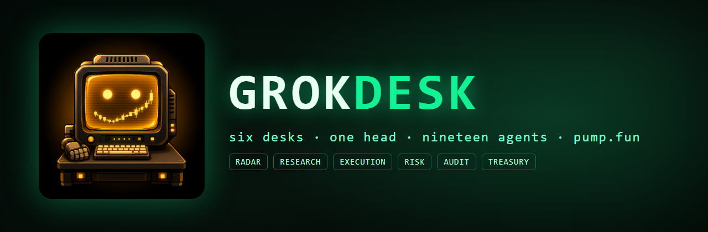

<p align="center">
  
</p>

<h1 align="center">GROK DESK</h1>

<p align="center">
  An autonomous <b>pump.fun</b> trading desk built out of small agents.<br>
  Six desks, one head of desk, and a firing loop that rewrites whoever underperforms.<br>
  <i>Paper trading. No wallet, no signing, no network required.</i><br>
  Plus <b>GROK SCALP</b>: a standalone crypto scalping &amp; signal engine with a Streamlit desk.
</p>

---

Most "grok trading desk" projects are a screenshot of a prompt. This one is an
actual desk: nineteen agents split across six desks, one head of desk called
**GROK CORE** that reads every desk once an hour and decides who gets more
budget and who gets fired, and an audit loop that keeps rewriting the scoring
matrix from realised P&L. Run it and it prints a funnel, a P&L, and a firing log.

## The org chart

```
                              ┌─────────────┐
                              │  GROK CORE  │  head of desk (agent 19)
                              │  never trades · hires & fires hourly
                              └──────┬──────┘
        ┌───────────┬───────────┬───┴───────┬───────────┬───────────┐
     RADAR      RESEARCH    EXECUTION      RISK        AUDIT      TREASURY
   scout        memory       exec        risk        hedge        vault
   feed         memory-2     sniper                  audit-2
   signal                    router
                             agent 01..07
```

| Desk | Agents | Job |
| --- | --- | --- |
| **RADAR** | scout, feed, signal | watch trends, fresh mints and whale wallets. read everything, buy nothing, ship a signal |
| **RESEARCH** | memory, memory-2 | score every signal on narrative, deployer history, wallet clusters and liquidity. pass all four or die here |
| **EXECUTION** | exec, sniper, router + agents 01..07 | greenlight, take the early curve, ladder out in tranches. only sees what cleared the filter |
| **RISK** | risk | caps position size, blocks the fourth open trade, freezes on drawdown. outranks the head |
| **AUDIT** | hedge, audit-2 | grade every closed trade, rewrite the research scoring matrix, rewrite fired agents |
| **TREASURY** | vault | bank profit, pay gas, sweep to cold storage, freeze if the wallet drops too far |

## How firing works

Once an hour **GROK CORE** reads the whole roster and fires the weakest seat.
Fired is literal: the **AUDIT** desk rewrites that agent from its own last window
of numbers, and the replacement config gets a clean slate to prove itself on.
The scoring matrix that **RESEARCH** runs on is not static either. Every loser
that fits a pattern nudges it stricter, so by the end of a run research is not
scoring the way it did on hour one. Nobody edited a prompt by hand.

## Quickstart

No dependencies. Python 3.10+.

```bash
python -m grokdesk                 # 72h paper run, live hourly HUD
python -m grokdesk --quiet         # just the final scoreboard
python -m grokdesk --hours 72 --tph 40 --start 5 --seed 42
python -m grokdesk --delay 0.05    # slow it down for a live feel
```

Flags: `--hours` sim length, `--tph` ticks per hour, `--start` wallet in SOL,
`--seed` rng seed (0 = random), `--delay` seconds between ticks, `--quiet`.

## What a run looks like

```
72 HOUR SCOREBOARD  (straight off the vault)
============================================================
  signals scanned :    28781
  cleared research:     5772
  entries taken   :      432
  wins / losses   : 177 / 159   (loss cost 17.44 SOL)
  graduations     :      177
  net             : 5.0 SOL -> 115.28 SOL
  matrix revisions: 8

  firings (4):
    - AGENT 01: redundant entries the early curve already had
    - AGENT 02: redundant entries the early curve already had
    - MEMORY:   underperforming on realised pnl
    - MEMORY-2: scoring deployer history too loosely, same funder cluster
```

Numbers move with the seed. Losing runs happen, that is the point of the risk
and treasury desks.

## Going live

RESEARCH scores narratives with an offline heuristic by default, so the whole
desk runs with zero network calls. Set `XAI_API_KEY` (or `OPENAI_API_KEY`) and
wire `grokdesk/llm.py:_remote_score` to a real Grok / OpenAI-compatible endpoint.
Everything else stays paper: there is no broker here that touches a chain, and
wiring one is deliberately left to you.

## The live dashboard

[`assets/terminal.html`](assets/terminal.html) is the desk as a single-file
terminal: the agent mesh, the mint stream, the P&L, the vault and the alert
feed. Open it in a browser.

---

# GROK SCALP

The second product in this repo: an all-in-one **crypto scalping & signal
engine**. It is not one strategy. It classifies the market regime first, then
re-weights eleven families of evidence (SMC/ICT, multi-timeframe, derivatives,
VSA/Wyckoff, indicators, volume profile, patterns, macro, sentiment, chart
vision, session) and only publishes a card when the confluence clears every
gate. Most of the time the correct output is **WAIT**, and the card says why.

The engine is standard-library Python. Streamlit, pandas, plotly and Pillow are
optional, for the dashboard and the offline chart reader.

```bash
python -m grokscalp --symbol BTCUSDT --tf 5m              # signal card, simulated market
python -m grokscalp --symbol SOLUSDT --tf 15m --live       # public Binance data, no keys
python -m grokscalp --symbol ETHUSDT --tf 5m --image chart.png
python -m grokscalp --scan BTCUSDT ETHUSDT SOLUSDT --tf 5m
python -m grokscalp --backtest --symbol BTCUSDT --tf 5m    # walk-forward, no lookahead
python -m grokscalp --backtest --live --calibrate          # writes config/calibration.json
```

The dashboard, two ways:

```bash
# 1) zero-install web dashboard, exactly what is deployed on Vercel
python scripts/vercel_dev.py            # http://localhost:8000

# 2) the full Streamlit desk (needs pandas/plotly)
pip install -r requirements-scalp.txt
streamlit run grokscalp/ui/streamlit_app.py
```

The web version is a static RTL page in `public/` plus one Python function in
`api/index.py`; the function only imports the standard library, so it runs on
Vercel's free tier. Same `SignalEngine.analyse` call, same card.

It gives you the signal card, the annotated chart, the evidence table with the
weight of every atom, the derivatives panel (OI, funding, CVD, book imbalance,
liquidation magnets, whale prints), news and macro, a walk-forward backtest tab
that calibrates the probability, a market scanner and the methodology.

Every number on screen comes from `SignalEngine.analyse`, so the CLI, the UI and
the JSON output never disagree. Full Persian guide, methodology and limitations:
[`docs/grok-scalp.md`](docs/grok-scalp.md).

What it refuses to fake:

- **No repaint.** Swings need `k` bars of confirmation, breaks are close-based.
- **No invented levels.** Stops sit behind the invalidation level plus an ATR
  buffer; targets are structure, volume profile or liquidation clusters, capped
  in R so a 5m card is not a swing trade.
- **No fake win rate.** Probability is the confluence model, then corrected by a
  walk-forward backtest. On synthetic data the measured hit rate is poor and the
  engine says so — run `--live --calibrate` before trusting any number.
- **No public forceOrders.** The liquidation map is estimated from swing
  liquidity and labelled as such.
- **No keys, no orders.** Read-only public endpoints. Nothing here signs or sends
  a trade.

## Layout

```
grokscalp/          the scalping signal engine
  engine.py         snapshot -> evidence -> gates -> card
  structure.py      BOS, CHoCH, order blocks, FVG, liquidity, OTE
  indicators.py     RSI/MACD/ATR/Bollinger/Ichimoku/VWAP/ADX/volume profile
  patterns.py       candles, harmonics, VSA/Wyckoff, chart patterns
  derivatives.py    CVD, OI, funding, book imbalance, liquidations, whales
  regime.py         regime detection + the routing table
  confluence.py     weighted evidence, edge, conflict, gates, calibration
  risk.py           entry, stop, targets, R:R, leverage, sizing
  vision.py         chart screenshot reader (vision API or offline Pillow)
  backtest.py       walk-forward validation
  data/             deterministic synthetic market + public Binance adapters
  render/           Persian/English signal card + Plotly chart
  ui/               Streamlit desk
grokdesk/
  bus.py            async pub/sub the desks talk over
  llm.py            grok / openai-compatible wrapper (offline fallback)
  scoring.py        the mutable scoring matrix AUDIT rewrites
  ledger.py         wallet + cold vault + P&L
  head.py           GROK CORE, the head of desk
  runtime.py        wires the desks and runs the sim
  market/           bonding curve, paper pump.fun feed, paper broker
  desks/            radar, research, execution, risk, audit, treasury
config/desk.yaml    the org chart as data
config/scalp.yaml   the signal engine's routing table as data
docs/grok-scalp.md  the engine, in Persian, end to end
assets/             logo, banner, terminal.html
```

## Disclaimer

Paper trading and a simulation. GROK SCALP is an analysis engine: it reads public
data and prints probabilistic cards. It is not financial advice, not a live
trading bot, and nothing here signs a transaction or sends an order. Scalping
with leverage can lose money faster than any model can warn you — position
sizing, venue risk and the outcome are yours.

## License

MIT
